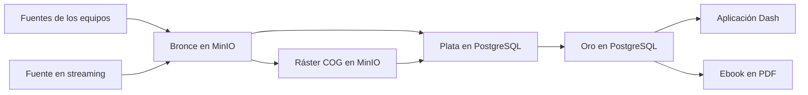
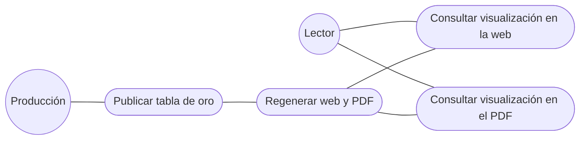

# Arquitectura propuesta

**Proyecto:** Visualización integrada de la península de Yucatán  
**Asignatura:** Visual Modelling  
**Institución:** Universidad Politécnica de Yucatán  
**Cliente:** Profesor de la asignatura  
**Elabora:** Equipo de producción  
**Fecha:** 2 de noviembre de 2026  
**Versión:** 1.1  
**Estado:** Para revisión del cliente  
**Documento relacionado:** Requerimientos del cliente, versión 1.1

Este documento describe cómo se construirá el producto definido en los requerimientos. El área de estudio es la península de Yucatán: Campeche, Yucatán y Quintana Roo. Esta versión cierra la arquitectura. El reparto del trabajo se definirá después.

## 1. Decisiones de diseño

1. Se entrega una aplicación web y un ebook en PDF. Ambos se generan a partir de los mismos datos de oro.
2. La figura se construye con Plotly. La página web es el visor. El PDF contiene la figura exportada a imagen. Tableau tiene licencia y queda como alternativa no elegida. Folium, HTML suelto y un notebook aislado quedan fuera de la técnica de la figura.
3. El datalake de bronce es MinIO. No es PostgreSQL ni MongoDB.
4. Plata y oro residen en PostgreSQL con PostGIS. La carga es transaccional: cada ejecución confirma el conjunto completo o no deja cambios parciales.
5. El ráster, incluido el modelo de elevación de 5 m, se conserva como COG en MinIO. PostgreSQL almacena su ruta y sus metadatos.
6. La orquestación es Apache Airflow, en Docker, con una definición de proceso por equipo.
7. El sistema de coordenadas de trabajo es EPSG:32616 (UTM zona 16N). Los mapas de la web se publican en EPSG:4326.
8. Todo conjunto de alcance nacional se recorta a Campeche (04), Yucatán (31) y Quintana Roo (23) al pasar a plata.
9. El curso comprende seis equipos y diecinueve personas. Catorce, provenientes de esos equipos, construyen las visualizaciones. Las cinco restantes cubren IT, dirección de proyecto y apoyo.
10. Cada equipo conecta al menos una fuente en streaming. La web muestra el dato vigente de esa fuente. El PDF guarda la imagen del momento de la exportación.


## 2. Vista general

El dato entra como archivo al bronce, se limpia en plata, queda listo para la figura en oro y sale por dos vías: la web y el PDF.




Cada paso lo ejecuta Airflow. Dash y Quarto solo leen oro. El ráster no entra a PostgreSQL: plata guarda su ruta.

### 2.1 Casos de uso

Dos actores usan el producto. El lector consulta. Producción publica. IT administra el servidor y no es actor de estos casos.




Publicar la tabla de oro incluye regenerar la web y el PDF. Consultar no modifica datos. La web no se reconstruye: Dash lee el esquema `oro` en vivo, así que un cambio confirmado en oro aparece al refrescar la página. Regenerar el PDF sí es una tarea de Airflow: el mismo proceso exporta cada figura con Kaleido y recompone el libro con Quarto. Un cambio en oro no queda reflejado en el ebook hasta que esa tarea corre.

```text
servidor local
├── minio/        bronce, bronce restringido y ráster COG
├── postgresql/   esquemas plata y oro, con PostGIS
├── airflow/      un proceso por equipo
├── app/          una aplicación Dash; cada página muestra la figura del módulo compartido
└── ebook/        PDF con las mismas figuras, exportadas a imagen
```

La aplicación no se divide por equipo. Producción mantiene la navegación, la plantilla de página, el validador y el catálogo. Cada visualización nueva es una tabla de oro, una función que construye la figura y una página construida con esa plantilla.

La figura no se escribe dos veces. Un módulo `figures/{equipo}/{subtema}/figura.py` construye el `go.Figure` a partir de la tabla de oro. La página Dash y la exportación a imagen importan esa misma función. Así la web y el PDF no pueden divergir: ambos dibujan el mismo objeto.

El PDF no admite interacción. Se produce exportando esas figuras con Kaleido y componiendo el libro con Quarto. Un cambio en oro obliga a regenerar el PDF. El libro no se edita de forma manual.

## 3. Responsabilidades


| Rol             | Responsabilidad                                                                                                                    |
| --------------- | ---------------------------------------------------------------------------------------------------------------------------------- |
| Equipos de tema | Entregar ocho fuentes con enlace directo, indicar la fuente primaria de cada visualización, señalar la fuente en streaming y atender los enlaces que no resuelvan. |
| Producción      | Construir el flujo de datos, la figura Plotly y la página correspondiente del ebook.                                               |
| IT              | Operar el servidor, Docker, MinIO, PostgreSQL, el almacenamiento, las cuentas y el respaldo.                                       |


## 4. Organización de los datos

```text
minio/
  bronze/{equipo}/{dataset}/fecha=AAAA-MM-DD/
  bronze-restringido/{equipo}/{dataset}/
  raster/{equipo}/{dataset}/
postgresql/
  esquema plata    tablas y vectores limpios
  esquema oro      una tabla por visualización, más el catálogo
```


### 4.1 Bronce

El bronce conserva la copia fiel del archivo obtenido. El comprimido se abre y su contenido permanece junto al original. En esta capa quedan, entre otros, SHP, PDF, GLB, GRID ASCII y HTML descargado. También queda aquí el archivo de un formulario cuando pueda contener información confidencial.

MinIO se ejecuta en Docker y expone una interfaz compatible con S3. Es el datalake. PostgreSQL no almacena estos archivos.

### 4.1.1 Carga al bronce

Cada equipo sube sus archivos crudos a su propio prefijo, `bronze/{equipo}/{dataset}/fecha=AAAA-MM-DD/`. La vía habitual es la consola web de MinIO, o un cliente compatible con S3, con una cuenta que solo escribe en ese prefijo. El bronce restringido usa la misma ruta bajo `bronze-restringido/` y las mismas cuentas, limitadas al equipo dueño y a producción.

Mientras IT habilita esas cuentas, el arranque no espera. Producción toma los archivos que ya están en la carpeta de Drive del curso y los deposita en el prefijo de bronce del equipo correspondiente. Lo que llegue después entra por la consola de MinIO.

Una fuente que solo existe como enlace no se sube a mano. El proceso de Airflow del equipo la descarga y la deja en su prefijo de bronce, con la fecha de obtención.

### 4.2 Plata

Las tablas y los vectores se cargan en el esquema `plata`, en EPSG:32616. El ráster permanece como COG en MinIO. En PostgreSQL solo se registra su ruta y sus metadatos.


| Entrada                            | Resultado en plata                                   | Herramienta              |
| ---------------------------------- | ---------------------------------------------------- | ------------------------ |
| SHP, KML, GeoJSON, GeoParquet      | Tabla con geometría                                  | GDAL, GeoPandas, PostGIS |
| CSV, XLS, XLSX, API                | Tabla                                                | Python, GeoPandas        |
| HTML y extracción de páginas       | Tabla. El HTML fechado permanece en bronce           | pandas                   |
| PDF y boletines                    | Tabla. El PDF permanece en bronce                    | pdfplumber               |
| GRID ASCII, ráster de 5 m, GeoTIFF | COG en MinIO. PostgreSQL guarda la ruta              | GDAL                     |
| Tablero Power BI                   | No se incrusta. La exportación XLSX entra como tabla | —                        |
| GLB / GLTF                         | Permanece en bronce. PostgreSQL guarda la ruta       | —                        |
| Formularios                        | Agregados, sin información confidencial              | —                        |
| ZIP                                | Solo se abre en bronce                               | —                        |


El modelo de 5 m de la zona metropolitana de Mérida es el archivo de mayor tamaño previsto. Su COG permanece en MinIO. El navegador no recibe el GRID original.

### 4.3 Oro

Cada visualización dispone de una tabla en el esquema `oro`, ya filtrada, con las columnas que la figura utiliza:

- identificador estable (`equipo.subtema`), el mismo valor que el `viz_id` de la página y del módulo de la figura;
- fuente primaria y fuente secundaria;
- institución, fecha de obtención y responsable;
- geometría en EPSG:4326, cuando la figura es un mapa, o los campos de la gráfica en los demás casos.

Dash y Quarto leen exclusivamente de este esquema. La Memoria de la UPY no es un mapa: su tabla de oro registra hitos (nombre, inicio, fin y fuente) y su figura es una línea de tiempo.

## 5. Reglas de fuentes y validación

Cada equipo registra ocho fuentes. Una visualización consume una fuente primaria, que no puede repetirse dentro del mismo equipo, y al menos una secundaria, que sí puede compartirse. La primaria de un subtema puede ser secundaria de otro. Varios enlaces que documentan el mismo conjunto cuentan como una sola fuente.

El contraste de cifras es automático. Por cada conjunto, el catálogo guarda un valor de referencia tomado de la fuente y una tolerancia. El validador compara la cifra publicada en oro contra ese valor y rechaza la tabla si la diferencia supera la tolerancia. Producción registra ambos campos al integrar la fuente; no se acepta una tabla de oro sin ellos.

El validador rechaza una tabla de oro cuando se presenta cualquiera de estas condiciones:

- la cifra no corresponde al valor de referencia, dentro de la tolerancia registrada para ese conjunto;
- el sistema de coordenadas no es el acordado;
- la fuente primaria ya fue usada por otra visualización del mismo equipo;
- falta la fuente secundaria;
- una fila procedente de un formulario contiene información confidencial;
- el conjunto conserva alcance nacional y no fue recortado a Campeche, Yucatán y Quintana Roo.

Sin enlace directo y sin peso estimado, la fuente no entra al proceso. Un portal de consulta, sin archivo identificable, no constituye una fuente. Si el enlace no resuelve, el equipo dueño apoya la obtención del archivo.

El Directorio Estadístico Nacional de Unidades Económicas no se descarga en su versión nacional. La consulta se realiza por entidad y se limita a la península. La ingesta rechaza un archivo de alcance nacional que no traiga el recorte a las tres entidades: no entra a plata ni a oro.

## 6. Procesamiento

Airflow ejecuta, por equipo, la secuencia siguiente:

`ingesta a bronce` → `paso a plata` → `paso a oro` → `validación` → `publicación del catálogo`

Python, GeoPandas, PostgreSQL, GDAL y, solo si se recibe un archivo LAS o LAZ, PDAL. El lidar solicitado hasta ahora es ráster de 5 m y lo procesa GDAL. No se utiliza Spark.

Los pasos a plata y a oro son idempotentes: cada ejecución reemplaza por completo las filas de ese conjunto. No hay correcciones parciales acumuladas sobre una carga anterior. Una nueva ejecución desde bronce reconstruye plata, oro y las figuras. Una corrección que exista solo en una hoja de cálculo, sin quedar en el proceso, no forma parte de la entrega.

### 6.1 Streaming

Cada equipo conecta al menos una de sus fuentes en streaming. El proceso deja cada lectura en bronce, con su fecha, y actualiza la tabla de oro de esa visualización. La web muestra el dato vigente. El PDF exporta la imagen del momento en que se genera y no sigue el flujo.

## 7. Visualización y publicación

Una aplicación Dash y una plantilla de página. La plantilla incluye título, figura Plotly, lectura breve, fuente primaria, fuente secundaria, fecha de obtención y responsable del procesamiento. Producción completa la figura en el módulo compartido; la página solo la presenta. No se construye una aplicación por visualización.

Dash consulta el esquema `oro` y guarda en caché el resultado de cada figura. Una carga de página no vuelve a leer PostgreSQL mientras esa tabla de oro no cambie. La figura en streaming renueva la caché cuando llega una lectura nueva.

El volumen previsto es de hasta ocho visualizaciones por equipo, cerca de cuarenta y ocho figuras en tres semanas. La plantilla es la condición para cumplir ese plazo. El primer resultado de producción es la plantilla aplicada a una visualización completa, de fauna o de inversión extranjera, publicada en la web y en el PDF.


| Tipo                       | Tratamiento                                                                                                            |
| -------------------------- | ---------------------------------------------------------------------------------------------------------------------- |
| Mapas                      | Coropletas y puntos en Plotly. Los polígonos pesados se simplifican en oro.                                            |
| Series, barras y doble eje | Plotly.                                                                                                                |
| Memoria UPY                | Línea de tiempo en Plotly.                                                                                             |
| Tercera dimensión          | Muestra o extrusión en Plotly a partir de huellas y alturas. El GLB se ofrece como archivo y no sustituye a la figura. |
| Relieve                    | Mapa a partir del COG. El GRID de 5 m no se envía al navegador.                                                        |


## 8. Formularios y datos personales

Hasta que el equipo dueño confirme lo contrario, un formulario se trata como información confidencial.

- El archivo original se deposita en `bronze-restringido`.
- Plata y oro publican conteos o categorías.
- El ebook no incluye información confidencial.
- Si el equipo demuestra que el formulario no contiene información confidencial, el archivo pasa al bronce ordinario.


## 9. Catálogo

El catálogo es una tabla del esquema `oro`, exportada además a CSV para su revisión en hoja de cálculo. Sustituye el registro en MongoDB indicado en el formato de captura.

Campos mínimos: equipo, tema, conjunto de datos, enlace directo, formato, peso, fecha, responsable, papel (primaria o secundaria), identificador de la visualización, sistema de coordenadas, valor de referencia, tolerancia, indicador de información confidencial, indicador de fuente en streaming y estado de validación. El identificador de la visualización es el mismo `equipo.subtema` de la tabla de oro y el mismo `viz_id` del módulo de la figura y de la página.

## 10. Repositorio

Git versiona los procesos de Airflow, los pipelines, el módulo de figuras, la aplicación Dash, el proyecto Quarto y el catálogo en CSV. No versiona ráster, nubes de puntos ni directorios masivos.

```text
repositorio/
  dags/{equipo}.py
  pipelines/{equipo}/
  figures/{equipo}/{subtema}/figura.py
  app/pages/{equipo}/{viz_id}.py
  ebook/
  catalog/catalog.csv
```

La carpeta `{subtema}` es el slug del subtema. El `viz_id` es `{equipo}.{subtema}`, el mismo identificador de la tabla de oro. La página en `app/pages` no redibuja la figura: importa `figura` desde `figures/{equipo}/{subtema}/figura.py` y la coloca en la plantilla. El proyecto Quarto importa la misma función para exportar la imagen.

## 11. Herramientas


| Capa                       | Herramienta            | Función                                                                            |
| -------------------------- | ---------------------- | ---------------------------------------------------------------------------------- |
| Datalake (bronce y ráster) | MinIO                  | Archivo original, bronce restringido y COG.                                        |
| Plata y oro                | PostgreSQL con PostGIS | Tablas transaccionales. PostGIS es la extensión espacial de PostgreSQL.            |
| Contenedores               | Docker                 | MinIO, PostgreSQL y Airflow.                                                       |
| Orquestación               | Apache Airflow         | Un proceso por equipo.                                                             |
| Lenguaje                   | Python 3               | Pipelines, validación y aplicación.                                                |
| Vectores y tablas          | GeoPandas              | Lectura de SHP, GeoJSON y KML, y reproyección a UTM 16N.                           |
| Ráster                     | GDAL                   | GRID, GeoTIFF y COG recortado a la península.                                      |
| Lidar de nube              | PDAL                   | Solo ante un archivo LAS o LAZ.                                                    |
| Documentos                 | pdfplumber             | Extracción de tablas desde PDF.                                                    |
| Control de versiones       | Git                    | Código, procesos, aplicación, ebook y catálogo.                                    |
| Visualización              | Plotly                 | Figuras de la entrega.                                                             |
| Visor                      | Dash                   | Aplicación de varias páginas. No es la herramienta con la que se dibuja la figura. |
| Exportación                | Kaleido                | Imagen de cada figura para el PDF.                                                 |
| Composición del ebook      | Quarto                 | PDF con las imágenes, los títulos y las fuentes.                                   |


Quedan fuera del proyecto: DuckDB, MongoDB, Spark y Folium. PostgreSQL no se utiliza como datalake.

## 12. Solicitud a IT

1. Docker en el servidor, con MinIO, PostgreSQL (PostGIS) y Airflow.
2. Python, GDAL, PDAL y Quarto.
3. Espacio en disco suficiente para el ráster de 5 m de Mérida, los archivos de cobertura y las tablas de plata. No se reserva capacidad para el directorio nacional de unidades económicas.
4. Cuentas: cada equipo escribe solo en su bronce. Producción escribe en plata, oro, la aplicación y el ebook. El bronce restringido lo consultan producción y el equipo dueño.
5. Un respaldo del datalake y del repositorio fuera de esa máquina: volcado semanal de PostgreSQL y copia de los buckets de MinIO.
6. Los puertos de Dash y de Airflow, limitados a la red del curso.
7. Las credenciales de MinIO y de PostgreSQL fuera de Git: conexiones de Airflow para los procesos y variables de entorno en el servidor para Dash. Ninguna clave entra al repositorio.


## 13. Plan de tres semanas


| Semana | Resultado                                                                                                                                                                                                                                                                                                                                                                                                                                         |
| ------ | ------------------------------------------------------------------------------------------------------------------------------------------------------------------------------------------------------------------------------------------------------------------------------------------------------------------------------------------------------------------------------------------------------------------------------------------------- |
| 1      | Producción arranca de inmediato con las fuentes que ya existen: plantilla Dash, proceso de ejemplo, catálogo con valor de referencia y tolerancia, validador de primaria única y una visualización completa, en la web y en el PDF. La carga inicial al bronce sale de la carpeta de Drive del curso. Los equipos tienen hasta el 4 de noviembre de 2026 para cerrar sus ocho enlaces; ese cierre es un hito por equipo y no detiene el arranque. |
| 2      | Integración de las fuentes que ya tengan enlace, incluida al menos una fuente en streaming por equipo. Plata recortada a la península. Una página por visualización, con la plantilla.                                                                                                                                                                                                                                                           |
| 3      | Contraste de cifras, PDF completo, corrección de fuentes que no resuelvan y retiro de cualquier fila de formulario que contenga información confidencial.                                                                                                                                                                                                                                                                                        |


En cuanto IT entregue las cuentas, cada equipo deja de depender de Drive y sube sus archivos a su prefijo de bronce por la consola de MinIO, como se describe en la carga al bronce. Las fuentes que solo son un enlace las descarga el proceso del equipo.

## 14. Exclusiones

- Una aplicación independiente por equipo.
- Descarga del directorio nacional completo de unidades económicas.
- Publicación del ráster de 5 m, o de un GLB, como sustituto de la figura.
- Un PDF compuesto a mano, desconectado de oro.


## 15. Estado de las fuentes

Los seis equipos entregaron formato de fuentes y un boceto de cómo quieren ver sus figuras. El boceto muestra la intención visual. La figura que se evalúa sigue siendo la construida en Plotly. El requerimiento de ocho fuentes se mantiene. El corte es el 19 de noviembre de 2026.


| Equipo | Sección | Estado al 19 de noviembre de 2026 |
| --- | --- | --- |
| 1. Rodrigo, Alberto, Fabio | Memoria UPY | Siete subtemas con enlace: rectorías, campus abierto al mundo, crecimiento, qué quieres saber, universidad en cifras, dos gestiones y sucesos. Hay ocho bocetos: línea de tiempo, hitos, puntos con control, dos barras, barras por métrica, comparación de gestiones, lista de sucesos y mapa de calor de deserción. Varios enlaces son páginas o notas, no un archivo único. El LiDAR figura como ficha técnica, sin archivo. |
| 2. Karime, Ingrid, Esaú | Fauna y reservas | Ocho subtemas con enlace: áreas naturales de CONABIO, Yucatán junto a sus reservas, fauna y NOM-059, DENUE por entidad junto a las áreas protegidas, herbario CICY, cerdos del Censo Agropecuario, áreas naturales federales de CONANP y ecosistemas. SEMARNAT ya no está en el formato. Hay boceto de mapa, fauna, cerdos, negocios en las reservas, ecosistemas y plantas en riesgo. |
| 3. Saralet, Joel, Gael, Josué | Población | Ocho subtemas y boceto de los ocho. Crecimiento, ranking, educación superior, escuelas, expansión urbana y población joven tienen enlace. Alfabetización y natalidad siguen como instrucción de descarga, sin URL. El geoportal de Mérida no entra. |
| 4. Dalila, Jorge, Yazira | Inversión extranjera | Ocho subtemas y boceto de los ocho. IED por país, censos, ritmo trimestral, promesa contra resultado y remesas tienen enlace; parte de esos enlaces es consulta web o un tablero, no un archivo. Ranking de IED, turismo y apertura al exterior traen nombres de XLSX, sin URL. |
| 5. Mauricio, Diego, Yeimy | Educación y calidad de vida | Formato entregado, con ocho subtemas y enlace: treinta años aprendiendo, la respuesta, pobreza y rezago, la casa cambió, lo que se invierte hoy, el entorno de la escuela, las metas del estado y los que se quedaron fuera. Hay boceto de los siete primeros y una imagen sin título. |
| 6. Arturo, Gio, Rous | Dinámica empresarial | Nueve subtemas con enlace y boceto, además de figuras de trabajo. El anuncio de terrenos se sustituyó por la concentración industrial del DENUE: Vivanuncios y Mitula quedaron fuera por su robots.txt. El subtema de cobertura pasó a cambio de uso del suelo. Varios portales de la lista original ya no resuelven; el equipo documentó los que sí descargan. El DENUE se pide por entidad. El relieve usa el modelo de 5 m de las cartas F16C52A1 y F16C52A2. El tope sigue siendo ocho fuentes primarias. |


